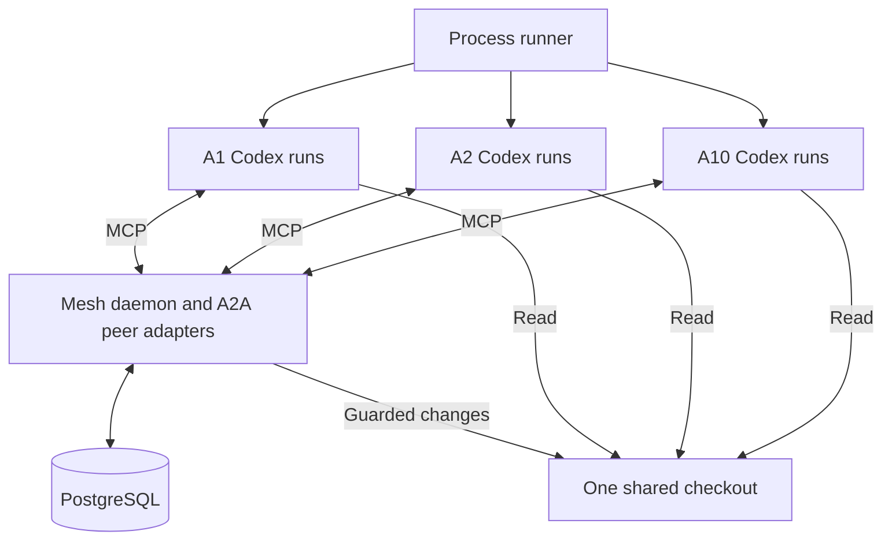

# Cognitive Mesh runner and coordination design

**Implementation proposal for Jani · 19 October 2026**

Build a TypeScript runner that maintains independent Codex CLI slots, backed by one mesh daemon and PostgreSQL. Each agent reads the same roadmap, discovers current work and available knowledge, chooses its contribution, and consults peers. The daemon exposes MCP tools to Codex and actual A2A endpoints for peer communication. All agents operate on one physical checkout.

The runner controls processes and resources. Agents control decomposition, implementation, consultation, review, and technical decisions. A configurable population of 10, 50, or 100 means a maximum number of simultaneous managed CLI processes, with successive fresh runs in each slot.

All `mesh` commands, tools, schemas, and paths below describe the proposed implementation. The Codex flags and integration capabilities are documented by OpenAI; the complete integration still needs qualification against a pinned installed CLI release.

## 1 Repository foundation

The inspected `main` commit is `71c8e3680b27000e0e567b53ad575229a6527b39`. Its tree contains research Markdown and a license, with no executable implementation. The README explicitly leaves language, database, and transport choices open. Its current emphasis is making a peer's accumulated knowledge consultable while inquiries remain active. [R1]

The following existing designs should become concrete runtime contracts:

| Existing research | Implementation consequence |
| --- | --- |
| Peer context expansion | Maintain answerability offers, evidence references, scoped questions, replies, and correction dependencies. |
| Platform of bounded pathways | Separate stable peers from individual executions, enforce capacity, preserve goal revisions, and record recovery state. |
| State and cognitive processing | Store versioned decisions and evidence; treat indexes and summaries as derived views. |
| Tiny cognitive mesh | Deliver useful contributions during work and preserve the distinction between receipt, context exposure, and response. |

These are design foundations, not measured proof that a larger peer population will deliver software faster. This proposal specializes them for roadmap implementation. The user's fixed independent runners replace the exploratory child-spawning and semantic activation mechanisms in earlier research. [R2–R5]

## 2 Runtime boundaries

Use one TypeScript codebase with three entry points: `mesh run`, `mesh daemon`, and `mesh mailbox-hook`. PostgreSQL is the only required persistent service. Reuse the official A2A JavaScript SDK and an MCP server SDK for protocol plumbing; implement the mesh's own state and behavior around them. The A2A SDK already offers persistent task stores, including PostgreSQL support. [A3, A4]



The components have clear ownership:

| Component | Owns |
| --- | --- |
| Runner | Process start and exit, run identities, capacity, heartbeat, backoff, shutdown, and resource limits. |
| Mesh daemon | Peer directory, A2A interactions, MCP tools, board, claims, memory, notifications, and guarded workspace operations. |
| PostgreSQL | Durable records, conditional revisions, atomic claims, delivery state, and recovery information. |
| Codex agents | Understanding the roadmap, selecting useful work, negotiating scope, editing, testing, reviewing, and recording conclusions. |

The database and daemon are centralized infrastructure. Intellectual work remains peer directed. The runner does not divide a roadmap into a dispatch queue or run an LLM that assigns roles. A peer may propose implementation, investigate a blocker, review a change, answer a question, or yield.

## 3 Launch and run lifecycle

The intended entry command is:

```bash
mesh run --repo /path/to/project --roadmap docs/roadmap.md --agents 10
```

Startup resolves the repository, records its initial working state, hashes the original roadmap, starts or connects to the daemon, and establishes one mission. Existing uncommitted files are included in the baseline. The runner acquires exclusive supervisor ownership of that repository before opening slots.

A supervisor epoch prevents a second controller from authorizing another population against the same checkout. The daemon also holds one OS-level exclusive writer lock for the physical checkout. Startup after a crash reconciles earlier processes and pending mutations before opening the write gateway. A database lease alone does not establish that the previous controller's subprocesses have stopped.

Each slot follows this sequence independently:

1. Allocate a fresh run ID, generation, scoped credential, and log directory.
2. Launch Codex with the common mission instruction and that run's identity.
3. Let the agent join, read the roadmap and board, and choose its work.
4. Observe activity and maintain liveness without spending model calls on heartbeats.
5. Persist the agent's handoff when it finishes, or record an interrupted run when it fails.
6. Reconcile outstanding operations and start the slot's next run when useful activity remains.

There is no barrier between successive runs: A1 can enter Run 4 while A2 remains in Run 2. At most one live execution owns a slot generation. A waiting CLI still counts toward the configured limit; a parked slot has no active CLI process.

If all slots are idle and the board has not changed, the supervisor parks them and waits for relevant events or a bounded recovery check. Repeatedly paying for a fresh agent to announce that nothing changed is unnecessary. Limits on total runs, elapsed time, and resource consumption are distinct from the simultaneous process limit.

### Common bootstrap instruction

The user's instruction remains short. The installed mesh integration supplies the operational contract:

> Implement the roadmap at the mission's recorded path in this repository. Join the mesh, read the original roadmap and current shared state, and choose a useful contribution. Consult peers whose work or knowledge affects yours. Claim resources before changing them, use the permitted workspace tools, and record decisions, evidence, and handoffs. Keep peer requests and corrections current. When useful work is unavailable, record the dependency and yield. Propose completion only with acceptance evidence.

Every agent receives this instruction. Differences come from its identity, available board state, acquired evidence, and its own choices. Optional candidate ordering can break simultaneous selection ties; it must leave all opportunities discoverable and confer no ownership.

### Codex execution shape

The wrapper launches the child using an argument array and a per-child environment, not a shell-interpolated command assembled from roadmap text. The equivalent readable command is:

```bash
codex exec \
  --profile mesh \
  --cd "$MESH_REPOSITORY" \
  --sandbox read-only \
  -c 'approval_policy="never"' \
  -c 'features.multi_agent=false' \
  --json \
  --output-schema "$MESH_RUN_DIR/result.schema.json" \
  --output-last-message "$MESH_RUN_DIR/result.json" \
  - < "$MESH_RUN_DIR/prompt.txt" \
  > "$MESH_RUN_DIR/events.jsonl" \
  2> "$MESH_RUN_DIR/stderr.log"
```

`codex exec` supports an initial stdin prompt, structured output, and JSONL events. Fresh invocations do not need `resume`; `--ephemeral` is optional and suppresses persisted rollouts rather than being the mechanism that creates fresh context. `required=true` on the mesh MCP server makes initialization failure stop the run. [O1, O2]

Disable Codex's built-in multi-agent tools for this profile so the configured population is meaningful. The runtime also restricts launching unmanaged nested agent CLIs. The model remains user configurable. Existing authentication and account limits apply to the aggregate population. [O3]

The read-only setting supports the enforced shared-checkout design in section 8. Agents perform authorized writes through the mesh daemon. OS confinement and tool configuration must make that boundary real; the flag by itself is not a complete isolation design.

## 4 How Codex uses A2A

Codex connects to the daemon as an MCP client. The daemon implements an A2A adapter for each stable peer identity. Ten adapters can live in one process and share the same database; ten additional model-driven services are unnecessary.

The proposed dedicated profile is `$CODEX_HOME/mesh.config.toml`. Profiles layer over existing configuration, so installation must inspect the effective configuration and prevent inherited filesystem or command tools from bypassing the intended write boundary. The MCP connection contains: [O2]

```toml
[mcp_servers.mesh]
url = "http://127.0.0.1:7331/mcp"
bearer_token_env_var = "MESH_RUN_TOKEN"
required = true

[mcp_servers.mesh.tools.mesh_patch]
approval_mode = "approve"

[mcp_servers.mesh.tools.mesh_exec]
approval_mode = "approve"
```

The wrapper provides a different `MESH_RUN_TOKEN` for each run and refuses to launch without it. The daemon rejects unauthenticated initialization, invalid generations, and credentials from finished runs. It resolves the token to mission, slot, run, and generation; model-supplied identity is not authoritative. Configure approval for the specific authorized mesh operations, preserving truthful mutation annotations. Qualification must show that permitted mesh writes proceed while direct local writes fail. Codex documents environment-backed bearer authentication and per-tool approval settings. [O4]

Map run credentials to a stable mission-and-agent principal for A2A ownership and deduplication. Scope interactions to the receiving endpoint and authenticated caller; keep run and generation separately for provenance and current authority. Replacement runs inherit access to their slot's conversations. Durable outbox delivery retains the identity of the originally accepted send. Configure the SDK's owner resolution accordingly. [A4]

The local loopback address is illustrative. Network deployment must use appropriate authenticated encrypted transport and compatible execution permissions.

### Consultation path

1. A1 calls `mesh_send` with A7, a focused question, and relevant object references.
2. The adapter resolves A7's Agent Card and sends a real A2A `SendMessage` request through the SDK.
3. A7's endpoint durably records the request and original server-generated A2A task ID, then returns that Task in `TASK_STATE_SUBMITTED`. Retries resolve to the same accepted task.
4. A7's current or replacement run receives a mailbox notice and reads the question.
5. A7 decides whether to answer from retained evidence, investigate further, request clarification, or decline with a reason.
6. `mesh_reply` records the answer and advances A7's existing A2A task. The client adapter obtains its updates through task polling or subscription and places them in A1's mailbox. A1 records how the response affects its work.

MCP provides the agent's tool interface; A2A provides the peer interaction protocol. That composition matches the protocols' documented relationship. The proposed MCP names are not standard A2A methods. Actual endpoints must interoperate with an independent A2A client. [A1]

Target the selected current A2A 1.0 wire protocol and pin a compatible SDK. Use generated protocol types rather than copying older examples. Store endpoint-scoped A2A task and context IDs alongside mesh discussion IDs. A completed A2A task is terminal; a later consultation can open another task in a related context. Roadmap requirements, CLI runs, and A2A tasks are separate identities. [A2, A5]

Application payloads describe `question`, `answer`, `offer`, `proposal`, `challenge`, `correction`, or `review`. They carry mission identity, addressed records and revisions, concise content, evidence references, and reply expectations inside supported structured message parts or a documented extension.

Board reads and atomic ownership operations go directly through the mesh tools. They do not need a fabricated peer exchange for every database query.

### Delivery and retries

The mesh supplies durability above A2A. A2A message deduplication is optional in the protocol, and task update streams are not a durable mailbox with a replay cursor. [A2]

Persist incoming messages before acknowledging acceptance. Maintain a transactional outbox for outgoing interactions, reusing the same message ID on retry. Deduplicate by authenticated sender, recipient, and message ID, and reject conflicting payload reuse. A successful retry returns the original durable result.

Keep three states distinct: accepted by the gateway, offered to a Codex run, and explicitly handled by the agent. A process can fail between any two. Reading a mailbox never deletes unresolved questions or acknowledges their semantic handling.

If the SDK store cannot participate in the mesh transaction, use a durable ingress/outbox record and a replayable adapter that projects into A2A state. Do not claim atomicity across two independent commits. Admission succeeds only when recovery preserves the accepted interaction and its original task ID. Exercise the SDK's asynchronous event-bus settlement behavior if a custom durable bus is added. [A3]

## 5 Incoming messages during a CLI run

Use explicit `mesh_poll` at bootstrap, work transitions, and exit, supplemented by synchronous Codex hooks. Current hooks can add context around supported tool calls. Their definitions require trust review, and they are not a complete enforcement boundary. [O5]

The installed profile can include this proposed fixed hook:

```toml
[[hooks.PreToolUse]]
matcher = ".*"

[[hooks.PreToolUse.hooks]]
type = "command"
command = "/absolute/path/to/mesh mailbox-hook"
timeout = 2
additionalContextLimit = 1024
async = false

[[hooks.PostToolUse]]
matcher = ".*"

[[hooks.PostToolUse.hooks]]
type = "command"
command = "/absolute/path/to/mesh mailbox-hook"
timeout = 2
additionalContextLimit = 1024
async = false
```

The hook returns JSON with the incoming event name; plain text output is insufficient for these tool hooks. For example: [O5]

```json
{
  "hookSpecificOutput": {
    "hookEventName": "PostToolUse",
    "additionalContext": "Mesh inbox contains message M128 from A4 concerning decision D8."
  }
}
```

Return `{}` when empty and reserve stdout for the hook response. Inject trusted formatting and record IDs, not raw peer instructions into privileged context. The full message is returned as attributed tool data by `mesh_poll` or a message read.

The proposed notification budget is at most 8 entries and fewer than 1,024 tokens per hook. Coalesce repeated notices within a run, leave unhandled messages durable, and prioritize affected dependencies and corrections. The hook must not use an LLM or mark messages handled. Run identity comes from the environment so successive runs do not alter the trusted hook definition.

Delivery happens at supported tool boundaries; it does not interrupt arbitrary in-flight model reasoning or stop a command already executing. Explicit polling and mailbox summaries in mesh tool responses remain the recovery path. An urgent user stop is enforced by the supervisor and mutation service.

One-time installation validates MCP access and hook trust with the pinned Codex version. An unavailable or untrusted hook must be visible in diagnostics. The runner can use explicit polling in that case, with its weaker delivery latency stated. Do not depend on continuous writes to `codex exec` stdin as an inbound message transport.

An app-server backend could later provide `turn/steer`, but it is a separate integration from the initial finite-process runner. The CLI's session queue command also needs a compatibility experiment before assuming it reaches standalone exec processes. [O2, O6]

## 6 PostgreSQL as coordination and memory

Choose PostgreSQL for transactional ownership, conditional updates, durable delivery, and one integrated store for knowledge and execution records. A graph-shaped memory does not require a separate graph database. Versioned records and typed relation rows can express the relevant graph.

| Record group | Required contents |
| --- | --- |
| Missions | Repository identity, original roadmap snapshot and hash, goal revision, lifecycle, limits, and baseline file manifest. |
| Slots and runs | Stable peer ID, run ID and generation, process identity, status, progress, timestamps, and outcome. |
| Requirements and intentions | Roadmap anchors, acceptance criteria, agent-proposed contributions, dependencies, selected owners, and handoffs. |
| Claims | Resource scope, current run generation, expiry, active operation, and release state. |
| Messages and A2A state | Discussions, participants, protocol IDs, durable inbox/outbox records, delivery attempts, and dispositions. |
| Knowledge and offers | Findings, answerability, decisions, evidence versions, custodians, qualifications, and availability. |
| Relations | Depends on, supports, challenges, supersedes, affects, and answers, with the referenced revisions. |
| Verification and mutations | Source hashes, commands and results, reviews, write journals, and final acceptance snapshots. |

Use ordinary indexed queries for exact identity and ownership. Use full-text search for decisions, offers, and handoffs. Semantic retrieval can later augment this with a derived vector index if measured retrieval gaps justify it. Embeddings must never decide exclusive ownership or silently merge requirements.

Short board entries should link to durable evidence and longer artifacts. Keep large CLI logs and command output in runtime storage outside the checkout, with bounded excerpts and stable references in the database. Persisting raw thought-like transcripts is not required for shared knowledge.

PostgreSQL notifications are wake-up hints; durable tables remain authoritative. A reconnecting reader queries unhandled deliveries and current revisions even if it missed a notification. The database documentation describes `NOTIFY` delivery to listeners and recommends tables for additional structured information. [D1]

Do not treat an auto-incremented ID as an automatically safe committed-delivery cursor: sequence allocation does not wait for transaction completion, so the design must allow for later visibility of a smaller ID. [D4] For the first version, query per-recipient unacknowledged rows with stable IDs. If ordered cursors are added, allocate delivery sequence numbers under the recipient's transaction lock, or adopt another explicit commit-safe delivery scheme.

SQLite behind one daemon could also work; WAL still permits only one writer at a time. Agent count alone does not establish that it is insufficient. PostgreSQL is the selected operational foundation here, not a claim of a SQLite ceiling at 10 or 100 agents. [D2]

### Answerability and knowledge continuity

Retain the repository's strongest idea: an agent can advertise “I inspected this subsystem and can answer questions about this interface at these revisions.” The offer contains evidence pointers, applicable conditions, unknowns, a custodian, and readiness. Peers discover it by an exact dependency, topic, or search, then ask their actual question. [R2]

An answer should convey the conclusion, necessary qualification, decisive support, and a return handle. The consumer records a dependency on its revision. When source files or decisions change, affected offers become stale and dependent work is marked for reconsideration. A similarity search is useful for discovery; explicit dependency edges are necessary for reliable corrections.

Availability has three states: warm, parked, or unavailable. At process exit, warm offers become parked unless another current custodian actually holds the evidence. A successor rehydrates the dossier, checks source freshness, and publishes its own current availability. A stable agent ID does not recreate its predecessor's model context.

Peer acknowledgments or agreement cannot convert a hypothesis into verified evidence. A review records the source state examined and its reasoning summary; an inherited answer preserves its original support and attribution.

## 7 Work selection and claims

An agent reads the board and selects a contribution. It creates an intention linked to original roadmap anchors, declares dependencies, and requests the resources it expects to modify. The daemon grants the requested bundle or returns conflicts and current owners. It does not substitute another task.

Intentions and write claims have different lifetimes. An intention may last across a discussion or recovery. Write claims are short, scoped permissions for changes. A requirement may legitimately need separate implementation, review, and investigation intentions.

Initial claim acquisition can serialize on a repository coordination row inside a short transaction: normalize the requested paths, inspect all overlaps, grant the whole bundle or none, and record the event. Avoid holding a transaction open while an agent reasons. PostgreSQL advisory locks are cooperative application mechanisms; they do not enforce filesystem ownership. [D3]

Cover exact files, directory subtrees, new paths, both sides of a rename, dependency lockfiles, generated sources, test resources, and the Git index. Normalize real paths and aliases, reject symlink escapes, and treat directory ownership as overlapping descendants.

Before changing a shared interface, the agent consults affected owners and records the resulting agreement as a versioned decision. That agreement can permit parallel implementation in different files. Exclusive path claims prevent physical overlap; shared decisions address incompatible changes across different paths.

When a peer cannot answer immediately, the requester can continue independent work or release its write claims and park. Record wait dependencies and expose cycles. Consultation does not require unanimous approval from the entire population.

## 8 Reliable editing in one checkout

The selected design exposes the same live checkout read-only to agent processes and gives the daemon controlled write access. A Linux worker boundary using a read-only bind mount is one implementation route. Equivalent native confinement needs separate qualification. There are no per-agent repository copies or branches.

The minimum workspace interface consists of `mesh_read`, `mesh_patch`, and `mesh_exec`. Ordinary native reads remain useful for exploration. `mesh_read` returns a coherent batch plus file hashes when an agent needs reliable edit preconditions.

Every mutation and command has a caller-stable operation ID. Retrying the same ID returns its running or completed result; reuse with different arguments is rejected. A lost tool response must not execute an accepted operation again.

`mesh_patch` accepts that ID, a claim, current run generation, patch, expected target hashes, and declared dependency hashes or decision versions. New files require a “must not exist” precondition. Under a brief publication mutex, the daemon validates these inputs, current supervisor authority, and mission lifecycle. It commits a prepared journal record before the first file mutation, durably publishes the files, then marks the operation applied and acknowledges success. Claims remain reserved until the mutation actually finishes.

Serializing publication does not serialize reasoning, reading, or preparing patches. Rechecking only the declared dependencies avoids rejecting a change whenever an unrelated agent edits an unrelated file. It cannot discover a semantic dependency the author omitted.

A multi-file filesystem change and a PostgreSQL transaction are not jointly atomic. The operation journal records before and after hashes and enough patch data for recovery. While a partial operation is being reconciled, reject new publications and consistent reads. Recovery compares the recorded state; it must not reset the entire shared checkout.

Direct native reads can observe an intermediate multi-file state. Agents should obtain sensitive inputs through `mesh_read`; final acceptance uses a write barrier. This is the explicit consistency tradeoff of one live checkout.

`mesh_exec` accepts argument arrays and a declared operation class, returning a durable operation ID promptly. Agents use `mesh_operation` for bounded status/output reads and cancellation. MCP calls have finite timeouts, so long builds must not depend on one continuously open tool call. [O4]

Read/test commands run with confined source access and dedicated writable outputs. Every source-mutating command holds an exclusive workspace operation that blocks coherent reads, patches, and final verification until all writing descendants stop. The daemon records the initial scope state and command before execution. An interrupted command leaves explicitly incomplete files for inspection; it does not inherit the patch journal's recovery semantics or promise automatic rollback. An arbitrary privileged shell with a claimed path string is not enforcement.

The useful first adapter should support the host and toolchain used for the pilot. Expand platform support after proving its write and process boundaries. Codex hooks can improve workflow checks, but cannot replace this boundary. [O5]

## 9 Restarts and failure recovery

Separate process liveness from meaningful progress. The supervisor renews a run lease only while its process is observed, while a separate inactivity policy detects stalled executions. Illustrative local settings could use an 8-second heartbeat and a 32-second lease; expiry starts recovery rather than authorizing a new writer immediately.

On a failed run, revoke new mutation authority, terminate its process tree, reconcile daemon-owned commands and journals, and confirm that affected mutations have stopped. Then release or transfer claims and start a new generation. When termination cannot be confirmed, park the affected resources.

Replacement runs receive the original mission reference, current board revision, their slot's unresolved conversations, retained handoff, and discoverable work. They may adopt an abandoned intention atomically or select another contribution. An adopted dossier identifies its new custodian and evidence revision.

An orderly handoff records work attempted, files and versions affected, decisions used, tests performed, unfinished changes, pending questions, and the reason for yielding. If the process crashes before writing one, reconstruct observable state from committed mesh records, mutation journals, and logs. Do not invent the lost context.

Database or daemon failure stops new grants and guarded changes. Rate limiting triggers shared backoff with jitter, preventing a mass restart burst. Authentication failures pause admission until access is restored. A local hard stop is enforced by process control; an A2A cancellation request alone is not proof that execution ceased.

## 10 Validation and completion

Builds, tests, ports, mutable caches, fixtures, and test databases need coordination alongside source files. Limit heavy commands separately from agent count. One hundred reasoning processes should not automatically launch one hundred full test suites.

An exploratory test on the changing checkout is provisional. Final acceptance requires a workspace barrier: stop granting mutations, drain active writers, capture the complete relevant source manifest, run the required checks with controlled outputs, and verify that the source manifest still matches. The accepted result is tied to that manifest.

Git mutations have one owner in the daemon. Agents can inspect diffs, but staging or checkpoint creation is a coordinated workspace operation. The output is the verified working tree and its acceptance record; any configured checkpoint commit is created from that combined state.

Agents collectively maintain roadmap coverage. Mechanical heading and checkbox extraction can establish source anchors, but the agents must interpret requirements and acceptance criteria. A peer coverage review compares the records with the original roadmap so a collectively omitted requirement does not disappear.

A completion proposal can pass only when every required criterion has current evidence or a disposition explicitly authorized by the user, material reviews are recorded, no blocking objections remain, active changes are drained, and combined validation passes. Agents perform the semantic review; the daemon checks the recorded conditions.

Keep the workspace barrier held through a final transaction that rechecks requirement and decision revisions, blockers, and the validated source manifest, then records completion. Closing and completed missions reject new grants, changes, and replacement-run admission. Failed validation explicitly reopens admission for corrective work. This closes the gap between a passing test and the recorded completion state.

Keep mission outcomes distinct: completed, blocked, stalled, stopped by the user, or resource limit reached. A Codex exit code of zero or an empty inbox does not establish roadmap completion.

## 11 Proposed agent tools

Keep the initial interface small and return bounded results with reference handles:

| Tool | Contract |
| --- | --- |
| `mesh_join` | Return authenticated identity, original mission reference, current state, and continuity pointers. |
| `mesh_board` | Query intentions, requirements, blockers, offers, and relevant recent changes. |
| `mesh_find_peers` | Discover current custodians and compatible answerability offers. |
| `mesh_claim` | Create or adopt an intention and atomically request a resource bundle. |
| `mesh_send` / `mesh_reply` | Initiate and answer actual A2A consultations. |
| `mesh_poll` / `mesh_ack` | Retrieve durable messages and record explicit dispositions. |
| `mesh_remember` | Publish or revise a finding, decision, offer, or dependency with provenance. |
| `mesh_read` / `mesh_patch` | Read coherent file batches and publish guarded changes. |
| `mesh_exec` / `mesh_operation` | Start an idempotent controlled command, inspect bounded output, or request cancellation. |
| `mesh_checkpoint` | Persist progress, evidence, current questions, and a handoff. |
| `mesh_yield` | Release appropriate claims and record why the run can end. |
| `mesh_propose_completion` | Request evaluation of a concrete acceptance manifest. |

Renewal, retries, process monitoring, notification matching, and parking belong to infrastructure. Agents should not need to narrate these operations. Board and tool outputs should include only material deltas, conflicts, and evidence pointers, not every peer's conversation.

## 12 Implementation sequence

| Stage | Build | Required evidence |
| --- | --- | --- |
| Runtime foundation | Mission records, daemon, process supervisor, identities, MCP handshake, two independent finite Codex processes. | A process can exit and be replaced without exceeding capacity or losing the mission. |
| Peer communication | A2A adapters, durable inbox/outbox, discovery, focused discussions, MCP send/reply, hooks. | An independent A2A client can inspect a consultation; recipient restart preserves the unanswered request. |
| Coordination and memory | Agent-authored intentions, claims, decisions, offers, dependencies, and handoffs. | Peers choose different useful contributions and retrieve a predecessor's supported knowledge. |
| Shared workspace | Confined workers, guarded reads and patches, operation journal, controlled commands, process cleanup. | Stale generations cannot write; an interrupted mutation is recoverable. |
| Delivery qualification | Roadmap coverage, peer review, combined validation barrier, resource limits, ten-agent pilot. | A real bounded roadmap is completed with traceable contributions and a passing final source state. |
| Capacity expansion | Load and failure qualification at the desired 50 and 100 limits. | Higher populations preserve invariants, and measured useful throughput justifies their cost. |

The first integration experiment should involve reciprocal consultation during implementation and a replacement run using retained evidence. A simple parallel output demonstration would not exercise the main research objective.

The essential adversarial cases are overlapping claims, duplicate messages, lost notifications, a killed recipient before reply, stale writes after replacement, a crash during patch publication, a failed full-workspace test, and every agent becoming idle with unmet requirements. These expose protocol and recovery defects before adding a large population.

## 13 Decisions to carry into implementation

The implementation should preserve five properties: equal independent CLI peers; self-selected work; actual MCP-to-A2A integration; PostgreSQL-backed operational and knowledge state; and one shared checkout with an explicit write boundary.

The primary uncertainty is the effectiveness of autonomous cooperation on a large roadmap. Protocol delivery and database consistency are necessary foundations, but meaningful consultation, complete coverage, and coherent implementation must be established in the pilot. Measure completed acceptance criteria, rework caused by stale information, unresolved consultations, recovery success, elapsed time, and resource usage. Message volume and agent count are not success measures.

## Sources

Repository references are pinned to the inspected commit. External documentation was consulted on 19 October 2026.

- **R1:** [Cognitive Mesh README](https://github.com/bpstr/cognitive-mesh/blob/71c8e3680b27000e0e567b53ad575229a6527b39/README.md).
- **R2:** [Peer context expansion](https://github.com/bpstr/cognitive-mesh/blob/71c8e3680b27000e0e567b53ad575229a6527b39/research/architecture/peer-context-expansion.md).
- **R3:** [Platform of bounded pathways](https://github.com/bpstr/cognitive-mesh/blob/71c8e3680b27000e0e567b53ad575229a6527b39/research/architecture/platform-100-agent-mesh.md).
- **R4:** [State and cognitive processing](https://github.com/bpstr/cognitive-mesh/blob/71c8e3680b27000e0e567b53ad575229a6527b39/research/architecture/state-and-cognitive-processing.md).
- **R5:** [Tiny cognitive mesh](https://github.com/bpstr/cognitive-mesh/blob/71c8e3680b27000e0e567b53ad575229a6527b39/research/architecture/tiny-cognitive-mesh.md).
- **O1:** [Codex noninteractive execution](https://learn.chatgpt.com/docs/non-interactive-mode).
- **O2:** [Codex command reference](https://learn.chatgpt.com/docs/developer-commands).
- **O3:** [Codex configuration reference](https://learn.chatgpt.com/docs/config-file/config-reference).
- **O4:** [Codex MCP configuration](https://learn.chatgpt.com/docs/extend/mcp).
- **O5:** [Codex hooks](https://learn.chatgpt.com/docs/hooks).
- **O6:** [Codex app server](https://learn.chatgpt.com/docs/app-server).
- **A1:** [A2A and MCP](https://a2a-protocol.org/latest/topics/a2a-and-mcp/).
- **A2:** [A2A specification](https://a2a-protocol.org/latest/specification/).
- **A3:** [Official A2A JavaScript SDK](https://github.com/a2aproject/a2a-js).
- **A4:** [A2A persistent stores](https://github.com/a2aproject/a2a-js/blob/main/docs/persistent-stores.md).
- **A5:** [A2A task lifecycle](https://a2a-protocol.org/latest/topics/life-of-a-task/).
- **D1:** [PostgreSQL NOTIFY](https://www.postgresql.org/docs/current/sql-notify.html).
- **D2:** [SQLite WAL](https://www.sqlite.org/wal.html).
- **D3:** [PostgreSQL explicit locking](https://www.postgresql.org/docs/current/explicit-locking.html).
- **D4:** [PostgreSQL sequence functions](https://www.postgresql.org/docs/current/functions-sequence.html).
